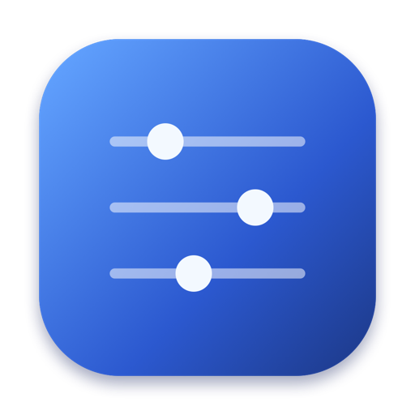

<div align="center">



# Device Deck

**Your whole Mac desk setup. One click away.**

A fast, lightweight, native macOS utility that unifies multi-display DDC/CI brightness, audio routing, keyboard backlighting, and automated dock profile switching in one window.

[](https://support.apple.com/en-in/102501)
[-purple?style=flat-square)](https://github.com/kapilyadav/devicedeck)
[](https://swift.org)
[](https://github.com/kapilyadav/devicedeck)
[](https://github.com/kapilyadav/devicedeck)

</div>

---

## ✨ Highlights

- **Multi-Monitor DDC/CI Brightness**: Physically control external display backlights and switch inputs (HDMI, DisplayPort, USB-C) via DDC/CI protocols, with automatic software dimming fallback.
- **Instant Audio Routing**: Side-by-side speakers and microphone selection with direct CoreAudio volume, gain, and mute controls.
- **Smart Dock Automation**: Bind audio and screen brightness to your Thunderbolt dock or USB hub — Device Deck auto-applies your profile the moment you plug in.
- **Keyboard & Mouse**: Adjust tracking speeds, natural scrolling, repeat rates, input layouts, and backlit keyboard brightness via CoreBrightness.
- **Closed-Lid Clamshell & Keep Awake**: Prevent sleep while connected to power and external displays, or start timed caffeinate sessions.
- **Battery Health**: Inspect cycle counts, nominal capacity, and jump straight to Apple's native 80% charge limiter on macOS Tahoe.
- **Menu Bar Extra & Hotkeys**: Runs in the background from a sleek sliders menu bar icon. Dim or brighten the screen under your mouse cursor with `⌃⌥⌘↑` and `⌃⌥⌘↓`.
- **Pure Native Speed**: Less than 15 MB of RAM, 0% idle CPU, and zero Electron bloat.

---

## 📥 Installation

1. Download **[Device-Deck-1.5.1.dmg](public/downloads/Device-Deck-1.5.1.dmg)**.
2. Open the DMG and drag **Device Deck.app** into your `/Applications` folder.

### 🛡️ Opening Past macOS Gatekeeper (First Launch)

As an independent open-source utility with an ad-hoc local signature, macOS may show a warning dialog on first launch (*"Apple cannot check it for malicious software"*).

**To approve in 2 clicks:**
1. In Finder, hold the **Control (⌃)** key and click (or right-click) **Device Deck.app**.
2. Select **Open** from the menu, then click **Open** in the dialog.
3. macOS permanently remembers the approval.

*Or via Terminal:*
```bash
xattr -cr "/Applications/Device Deck.app"
```

---

## 🛠️ Build from Source

Device Deck builds with pure system frameworks (AppKit, SwiftUI, CoreAudio, IOKit) with zero third-party packages or CocoaPods.

```bash
cd Source
./build.sh
```

The script compiles a Universal Mach-O binary (`arm64` and `x86_64`) into `build/Device Deck.app` and verifies its signature.

---

## 🌐 Website

The project includes an Apple-inspired Next.js 15 marketing site and interactive live simulator.

```bash
npm install
npm run dev
```

Visit [http://localhost:3000](http://localhost:3000) to preview.

---

## 👤 Author

Developed by **Kapil Yadav** — Built for macOS Ventura, Sonoma, Sequoia, and Tahoe.
